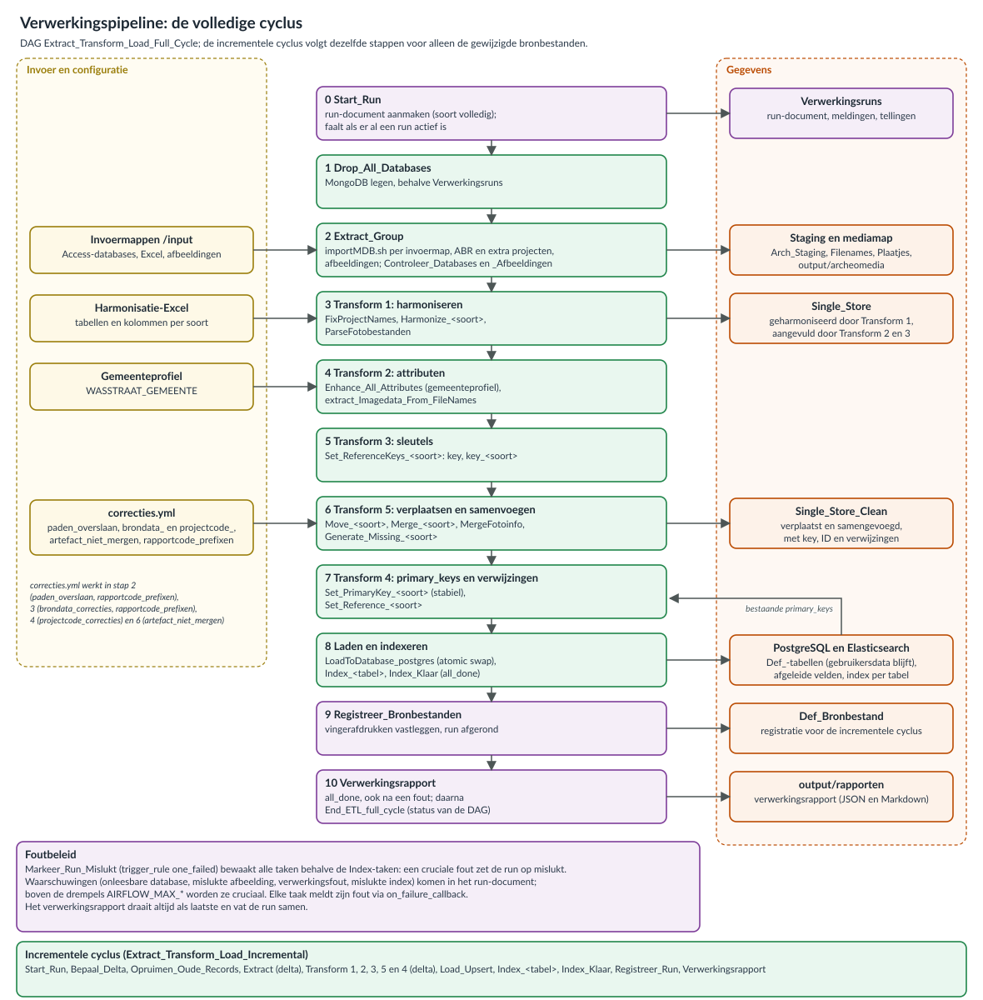

# Verwerkingspipeline

Deze pagina beschrijft hoe de brondata door de Wasstraat stroomt: van de Access-databases, foto's en rapporten in de invoermappen, via MongoDB, naar PostgreSQL en Elasticsearch. De verwerking is gebouwd als DAG's in Apache Airflow; de code staat in `airflow_app/dags/`.



## Twee cycli

| Cyclus | DAG | Wat hij doet | Wanneer |
|--------|-----|--------------|---------|
| **Volledige cyclus** | `Extract_Transform_Load_Full_Cycle` | Leegt de tussenopslag in MongoDB en verwerkt alle bronbestanden opnieuw. De tabellen in PostgreSQL worden in één keer vervangen (atomic swap), met dezelfde `primary_key`s als ervoor; gebruikersdata blijft staan | De eerste keer, en na een wijziging in de harmonisatie-Excel, `correcties.yml`, het gemeenteprofiel of de pipelinecode |
| **Incrementele cyclus** | `Extract_Transform_Load_Incremental` | Verwerkt alleen nieuwe, gewijzigde en verwijderde bronbestanden en werkt PostgreSQL en Elasticsearch bij (upsert); leegt niets | Na het toevoegen, vervangen of verwijderen van bronbestanden |

Beide cycli, en `DAG_Load_Only`, hebben een **run-document** in MongoDB (collectie `Verwerkingsruns` in `Arch_Staging`), houden zich aan hetzelfde **foutbeleid** en schrijven aan het eind een **verwerkingsrapport**. Er draait steeds hoogstens één run tegelijk. Zie [Foutbeleid en verwerkingsrapport](../componenten/verwerkingsrapport.md) en [Incrementeel laden](../componenten/incrementeel-laden.md).

## Stappen van de volledige cyclus

!!! note "Nummering van de taakgroepen"
    De taakgroepen van de transformatie zijn genummerd in de volgorde waarin ze ooit zijn gebouwd, niet in de volgorde waarin ze draaien: na Transform 3 komt eerst `Transform5_Move_And_Merge_Group` (verplaatsen en samenvoegen) en daarna `Transform4_Set_References_Group` (sleutels en verwijzingen). Deze documentatie volgt de namen in Airflow: Transform 5 is verplaatsen en samenvoegen, Transform 4 de sleutels en verwijzingen.

| # | Stap | Taken in Airflow | Leest | Schrijft |
|---|------|------------------|-------|----------|
| 0 | Run starten | `Start_Run` | – | Run-document (soort `volledig`, status `actief`) |
| 1 | Databases legen | `Drop_All_Databases` | – | Leegt `Arch_Staging`, `Arch_Files` en `Arch_Analyse` (behalve `Verwerkingsruns`) |
| 2 | Extractie | `Extract_Group`: `Extract_Data_From_Projecten`, `_Projectenlijst`, `_Magazijnlijst`, `_Fotolijst`, `_MonsterDB`, `_RapportaneDBs`, `Extract_Referentietabellen`, `Extract_ExtraProjecten`, `Controleer_Databases`; parallel `GetAndStoreImageFilenames`, `Extract_Data_From_Fotos_0` t/m `_7` en `Controleer_Afbeeldingen` | Invoermappen | Staging-collecties, `Filenames`, `Plaatjes`, de mediamap |
| 3 | Transform 1: harmoniseren | `Transform1_Harmonize_Group`: `FixProjectNames`, `fixMonsterProjectcds`, `Harmonize_<soort>` (één per soort), `ParseFotobestanden` | Staging, harmonisatie-Excel, `correcties.yml` | `Single_Store` |
| 4 | Transform 2: attributen | `Transform2_Enhance_Attributes_Group`: `Enhance_All_Attributes`, `extract_Imagedata_From_FileNames` | `Single_Store`, gemeenteprofiel | `Single_Store` (en fouten in `_processing_errors`) |
| 5 | Transform 3: sleutels | `Transform3_Set_Keys_Group`: `Set_Artefactnr_Unique`, `mergeRAAPArtefacts`, `Set_ReferenceKeys_<soort>`, `Set_Index_SingleStore` | `Single_Store` | `Single_Store` (velden `key`, `key_<soort>`) |
| 6 | Transform 5: verplaatsen en samenvoegen | `Transform5_Move_And_Merge_Group`: `Drop_SingleStoreClean`, `Move_<soort>`, `Merge_<soort>`, `MergeFotoinfo`, `Generate_Missing_<soort>`, `Set_Index_SingleStoreClean` | `Single_Store`, `Plaatjes` | `Single_Store_Clean` |
| 7 | Transform 4: sleutels en verwijzingen | `Transform4_Set_References_Group`: `Set_PrimaryKey_<soort>`, `Set_Reference_<soort>`, `Set_Reference_ABR_Materiaal`, `Set_Reference_ABR_SubMateriaal`, `Set_Reference_Images_to_Foto1` en `_Foto3` | `Single_Store_Clean`, PostgreSQL (bestaande `primary_key`s) | `Single_Store_Clean` (velden `ID`, `<soort>ID`) |
| 8 | Laden en indexeren | `Load_To_Database_And_Inxdex_Group`: `LoadToDatabase_postgres`, daarna parallel `Index_<tabel>`, dan `Index_Klaar` | `Single_Store_Clean` | PostgreSQL (`Def_`-tabellen), Elasticsearch |
| 9 | Registratie | `Registreer_Bronbestanden` | Invoermappen | `Def_Bronbestand`, run-document (`afgerond`) |
| 10 | Rapport en einde | `Verwerkingsrapport`, `End_ETL_full_cycle`; bij een fout ook `Markeer_Run_Mislukt` | Run-document, Airflow, PostgreSQL | Rapport in `AIRFLOW_OUTPUT_RAPPORTEN` |

### 2. Extractie

De zes MDB-taken roepen `airflow_app/scripts/importMDB.sh` aan met een invoermap en een staging-collectie. Het script zoekt recursief naar `.mdb`- en `.accdb`-bestanden (behalve de paden uit `paden_overslaan` in `correcties.yml`), exporteert elke tabel met `mdb-export` naar CSV, zet de tekst om naar UTF-8, voegt per record de velden `table`, `projectcd`, `bron`, `loadtime` en `mdbfile` toe en laadt het resultaat met `mongoimport` in de staging-collectie. De ABR-thesaurus en de extra projecten zijn Excel-bestanden die met pandas worden ingelezen.

De afbeeldingen en rapporten lopen apart: `GetAndStoreImageFilenames` zet de te verwerken bestanden in `Filenames`, acht taken maken per bestand drie formaten in de mediamap en een document in `Plaatjes`.

Na de import tellen twee controletaken wat niet gelukt is: `Controleer_Databases` (onleesbare en lege databases, overgeslagen tabellen) en `Controleer_Afbeeldingen` (mislukte en onverwerkte bestanden). Onder de drempel is dat een waarschuwing, erboven stopt de run. Zie [Extractie](../componenten/extractie.md).

### 3 tot en met 7. Transformatie

| Stap | Kern |
|------|------|
| Transform 1 | De [harmonisatie-Excel](../componenten/configuratie.md#4-harmonisatie-excel) bepaalt per soort welke Access-tabellen erbij horen en welke kolommen welk veld worden. Elk document krijgt `soort` en het oorspronkelijke record in `brondata`. Vooraf past `FixProjectNames` de `brondata_correcties` uit `correcties.yml` toe; `ParseFotobestanden` leidt uit de bestandsnamen af of een bestand een foto, tekening of rapport is |
| Transform 2 | Per document: de `projectcode_correcties`, de identificatie door het [gemeenteprofiel](../componenten/gemeenteprofielen.md) (projectcode, nummers als getal), dateringen, getallen, ja/nee-velden, datums en de omrekening van Rijksdriehoek-coördinaten naar WGS84 |
| Transform 3 | De samengestelde sleutel `key` van elk document (zoals `PDB034P10V460` voor vondst 460 in put 10 van DB034) en de sleutels naar de entiteiten waarnaar het verwijst (`key_vondst`, `key_put`, ...) |
| Transform 5 | Documenten gaan naar `Single_Store_Clean`: verplaatst (één op één) of samengevoegd (meer bronrijen met dezelfde sleutel worden één document). Ontbrekende putten, vlakken, sporen, vondsten en dozen worden aangemaakt uit de nummers in de andere documenten |
| Transform 4 | Elk document krijgt een stabiele integer-sleutel (`ID`, in PostgreSQL `primary_key`): bestaande nummers worden uit PostgreSQL overgenomen, alleen nieuwe entiteiten krijgen een nieuw nummer. Daarna worden de verwijzingen (`projectID`, `vondstID`, `artefactID`, ...) gezet |

Details: [Transformatie](../componenten/transformatie.md) en [MongoDB en Single_Store](../componenten/singlestore.md).

### 8. Laden en indexeren

`LoadToDatabase_postgres` (`loadToDatabase_functions.loadAll`) laadt elke tabel uit `LOAD_TABELLEN` naar een `_new`-tabel, wisselt die in één transactie om met de bestaande tabel (atomic swap, met tijdelijk verwijderde foreign keys), herstelt de foreign keys en ruimt de oude tabellen op. Daarbij blijven de gebruikerstabellen (bruiklenen, partijen, conservering, extra ABR-materialen) staan: verwijzingen naar rijen die verdwenen zijn, worden losgekoppeld met een markering. Daarna berekent de laadstap de afgeleide velden (aantal foto's per artefact, aantal artefacten per project, dateringen). Elke `Index_<tabel>`-taak bouwt de Elasticsearch-index van één tabel opnieuw op. Zie [Zoeken en indexering](../componenten/zoeken.md) en [Gegevensmodel](gegevensmodel.md).

De tabellen in PostgreSQL maakt de webapplicatie aan bij het opstarten (`db.create_all()`); de laadstap faalt als Flask niet heeft gedraaid.

### 9 en 10. Registratie, rapport en einde

`Registreer_Bronbestanden` legt van elk bronbestand een vingerafdruk vast in `Def_Bronbestand`, zodat een volgende incrementele run weet wat al verwerkt is, en zet het run-document op `afgerond`. `Verwerkingsrapport` schrijft het rapport van de run, ook na een fout.

## Foutbeleid en trigger rules

| Element | Werking |
|---------|---------|
| Cruciale taken | Alle taken en taakgroepen behalve de `Index_<tabel>`-taken hangen aan `Markeer_Run_Mislukt` (`trigger_rule=one_failed`). Faalt er een, dan zet die taak de run op `mislukt`; de registratie wordt niet bijgewerkt, zodat een volgende run dezelfde bestanden opnieuw oppakt |
| Index-taken | Een mislukte `Index_<tabel>` is een waarschuwing. `Index_Klaar` (`trigger_rule=all_done`) wacht op alle Index-taken, ongeacht de uitkomst; de registratie gaat door en de DAG slaagt |
| Drempels | Onleesbare databases, mislukte afbeeldingen en records die Transform 2 niet kon verwerken zijn waarschuwingen tot een drempel (`AIRFLOW_MAX_*`, zie [Configuratie](../componenten/configuratie.md#23-airflow-airflowenv-airflow_dbenv)) en cruciaal daarboven |
| Meldingen | Elke taak heeft een `on_failure_callback` die de foutmelding in de lijst `meldingen` van het run-document zet |
| Rapport | `Verwerkingsrapport` hangt aan alle andere taken met `trigger_rule=all_done`; de eindtaak hangt aan de registratie en het rapport en bepaalt de status van de DAG |
| Eén run tegelijk | `max_active_runs=1` en `Start_Run` faalt als er al een run actief is |

De volledige tabel per stap staat in [Foutbeleid en verwerkingsrapport](../componenten/verwerkingsrapport.md#beleid-per-stap).

## Stappen van de incrementele cyclus

```
Start_Run → Bepaal_Delta → Opruimen_Oude_Records → Extract_Group (delta)
  → Transform 1 → 2 → 3 → 5 → 4 (delta, stabiele sleutels)
  → Load_Upsert → Index_<tabel> (parallel) → Index_Klaar → Registreer_Run
  → Verwerkingsrapport → End_ETL_incremental
```

`Bepaal_Delta` vergelijkt de bestanden in de invoermappen met `Def_Bronbestand` en bepaalt per bestand of het nieuw, gewijzigd, ongewijzigd of verwijderd is. `Opruimen_Oude_Records` haalt de records van gewijzigde en verwijderde bestanden weg uit de staging en `Single_Store`. De extractie en de transformaties werken daarna alleen op de delta, met een extra taak `Werk_Geraakte_Projecten_Bij` in Transform 1 en 2. `Load_Upsert` werkt de tabellen in PostgreSQL bij met `INSERT ... ON CONFLICT` en verwijdert verdwenen rijen; de Index-taken werken alleen de tabellen uit `LOAD_TABELLEN` bij. Zie [Incrementeel laden](../componenten/incrementeel-laden.md).

## Overige DAG's

| DAG | Taken | Gebruik |
|-----|-------|---------|
| `DAG_Load_Only` | `Start_Run` → laden en indexeren → `Rond_Run_Af`, met run-document (soort `laden`) en rapport | Opnieuw laden of indexeren uit `Single_Store_Clean`, bijvoorbeeld na een mislukte Index-taak |
| `Extract_only` | `Drop_Staging_Database`, `Drop_Files_Database`, `Extract_Group` | Alleen inlezen |
| `Extract_Projects_only` | `Drop_Project_Collection`, `Extract_Data_From_Projecten` | Alleen de opgravingsdatabases opnieuw inlezen |
| `Redo_Images` | `Extract_Data_From_Fotos_0` t/m `_7`, `Controleer_Afbeeldingen` | Bestanden die in `Filenames` nog open staan (mislukt of onverwerkt) opnieuw proberen |
| `DAG_Transform_Only` | `Drop_Analyse_Database`, Transform 1, 2, 3, 5 en 4 | Alleen transformeren, zonder laden |
| `DAG_Transform_Load_Only` | Idem, plus laden en indexeren | Transformeren en laden zonder nieuwe extractie |
| `DAG_Transform1_Harmonize_Only` | `Drop_SingleStore`, Transform 1 | Stap voor stap debuggen |
| `DAG_Transform2_Enhance_Attributes_Only` | Transform 2 op de bestaande `Single_Store` (raakt `Single_Store_Clean` niet, zie [Transformatie](../componenten/transformatie.md#losse-dags-per-stap)) | idem |
| `DAG_Transform3_Keys_Only` | Transform 3 | idem |
| `DAG_Transform_Move_Only` | Transform 5 | idem |
| `DAG_Transform4_Refs_Only` | Transform 4 | idem |
| `DAG_Transform_Move_And_References_Only` | Transform 5 en 4 | idem |

Alleen de twee cycli en `DAG_Load_Only` hebben een run-document en een verwerkingsrapport. De andere DAG's registreren geen bronbestanden; draai na stapsgewijs werken weer de volledige cyclus voordat je de incrementele gebruikt.

## Uitgangspunten

- **De bron blijft onaangeroerd.** De invoermappen worden alleen gelezen; in de live installatie zijn ze alleen-lezen gekoppeld. Elk document in MongoDB en elke rij in PostgreSQL bewaart zijn oorspronkelijke record in `brondata`, met het pad van het bronbestand.
- **Herhaalbaar.** De volledige cyclus bouwt alles opnieuw op uit de bron en levert, bij dezelfde bron en configuratie, dezelfde rijen met dezelfde sleutels op.
- **Configuratie in plaats van code.** Tabel- en kolomnamen staan in de harmonisatie-Excel, gemeente-specifieke correcties in `correcties.yml`; alleen wat daar niet in te vangen is, zit in het gemeenteprofiel. Zie [Configuratie](../componenten/configuratie.md).
