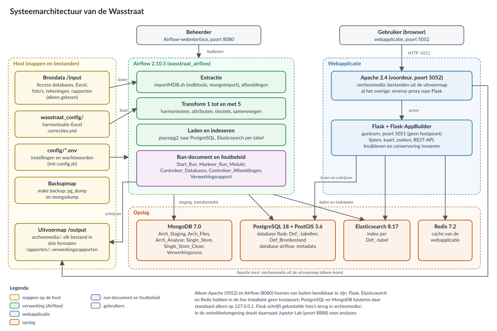
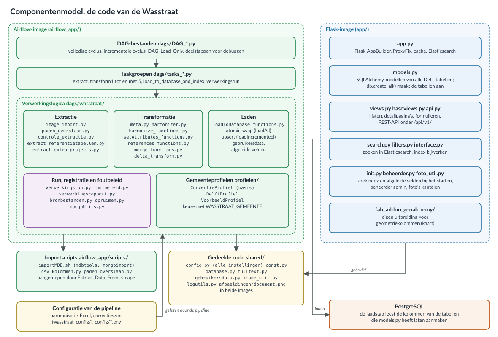
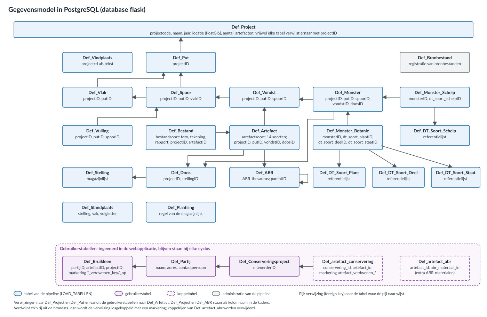
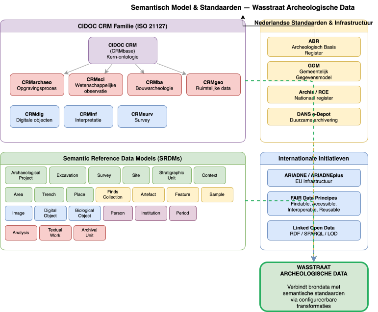

# Diagrammen

Deze pagina bundelt de diagrammen van de documentatie. Vier ervan beschrijven de Wasstraat zoals die nu is gebouwd; het semantische model is een toekomstbeeld.

## Huidige architectuur

| Diagram | Bestand | Staat op | Toont |
|---------|---------|----------|-------|
| Systeemarchitectuur | `assets/images/systeem-architectuur.svg` | [Systeemarchitectuur](architectuur/systeem.md) | De services (Apache als voordeur, Flask, Airflow, PostgreSQL met PostGIS, MongoDB, Elasticsearch, Redis), de mappen op de host en de gegevensstromen ertussen |
| Verwerkingspipeline | `assets/images/dataflow-pipeline.svg` | [Verwerkingspipeline](architectuur/dataflow.md) | De stappen van de volledige cyclus met hun taken in Airflow, de invoer en configuratie per stap, de gegevens die elke stap schrijft, het foutbeleid en de incrementele cyclus |
| Componentenmodel | `assets/images/componenten-model.svg` | [Componentenmodel](architectuur/componenten.md) | De code per image: DAG's, taakgroepen, de modules in `wasstraat/`, de importscripts, `shared/` en de webapplicatie |
| Gegevensmodel | `assets/images/gegevensmodel.svg` | [Gegevensmodel](architectuur/gegevensmodel.md) | De tabellen in PostgreSQL met hun verwijzingen: de tabellen van de pipeline, de gebruikerstabellen en de registratie van bronbestanden |








Klik op een diagram om het te vergroten; met scrollen zoom je in.

### Kleuren

| Kleur | Betekenis |
|-------|-----------|
| Geel | Mappen en bestanden op de host: brondata, configuratie, uitvoer, gedeelde code |
| Groen | Verwerking in Airflow |
| Blauw | De webapplicatie, en in het gegevensmodel de tabellen van de pipeline |
| Oranje | Opslag: MongoDB, PostgreSQL, Elasticsearch, Redis |
| Paars | Run-document en foutbeleid, en in het gegevensmodel de gebruikerstabellen (gestippeld: koppeltabellen) |
| Grijs | Gebruikers, en in het gegevensmodel de administratie van de pipeline |

### Diagrammen bijwerken

De vier SVG-bestanden worden gemaakt door het script `docs/assets/diagrams/genereer_diagrammen.py`. Het gebruikt alleen de standaardbibliotheek van Python, beschrijft elk diagram als een lijst kaders en pijlen en controleert na het schrijven of elk bestand geldige XML is. Pas bij een wijziging in de architectuur het script aan en maak de diagrammen opnieuw:

```bash
python3 docs/assets/diagrams/genereer_diagrammen.py
```

Bewerk de SVG-bestanden niet met de hand; de volgende keer dat het script draait, gaan die wijzigingen verloren. Het script zelf wordt niet in de gebouwde site opgenomen (`exclude_docs` in `mkdocs.yml`).

## Toekomstbeeld: semantisch model

**Bestanden:** `assets/images/semantisch-model.svg`, bron `assets/diagrams/semantisch-model.drawio` (te openen met [draw.io](https://www.diagrams.net/))

Dit diagram toont de semantische inbedding die de Wasstraat nastreeft: de CIDOC CRM-familie (CRM, CRMarchaeo, CRMsci, CRMba, CRMgeo), de groepen van semantische referentiedatamodellen, de Nederlandse standaarden (ABR, GGM, Archis, DANS e-Depot) en internationale kaders (ARIADNE, FAIR, Linked Open Data). Het beschrijft geen bestaande functionaliteit: de Wasstraat gebruikt nu alleen de ABR-thesaurus. Zie [Toekomstvisie](toekomstvisie.md).


